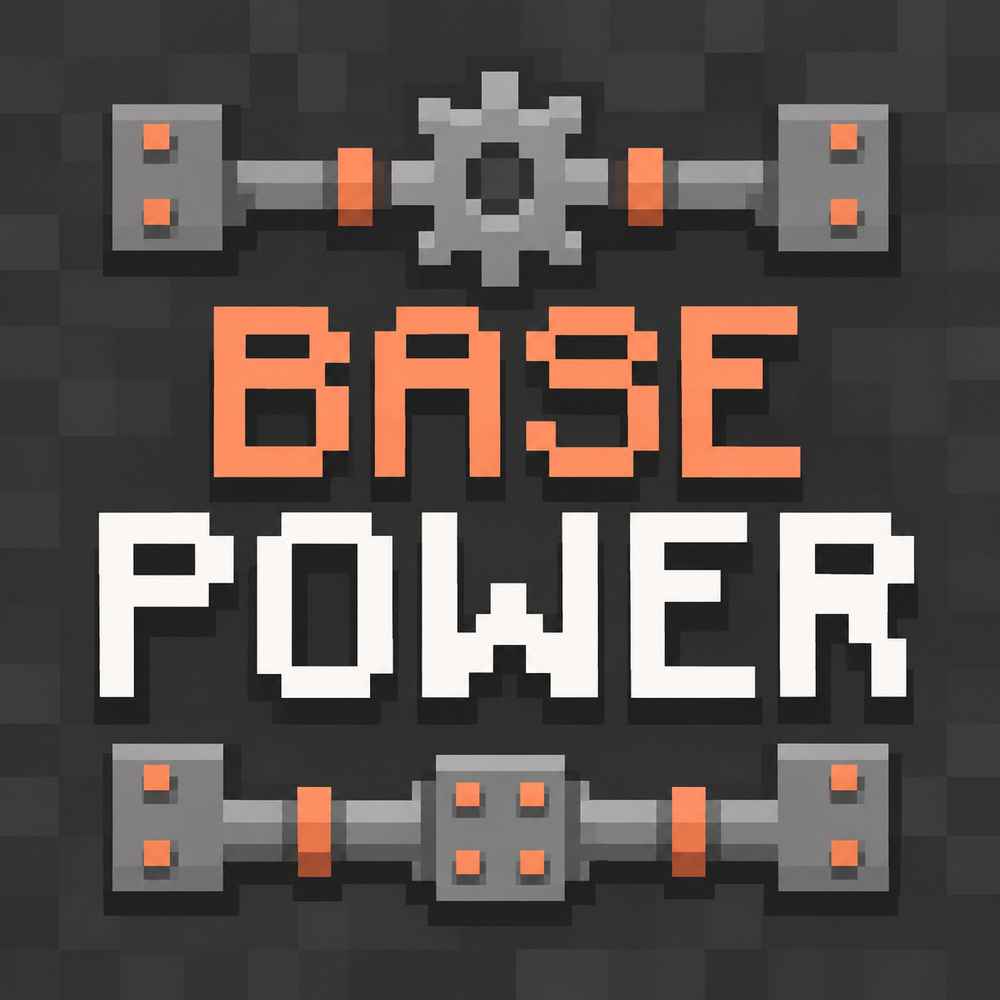

# basePower Artwork



`basepower-logo.png` is the square project logo for the basePower CurseForge listing. It is a 1,254 by 1,254 pixel PNG, meeting [CurseForge's current minimum](https://support.curseforge.com/support/solutions/articles/9000199552) of 400 by 400 pixels. Keep the square composition and its margins when exporting smaller copies.

The copper and white pixel lettering, dark metal background and copper fasteners follow the [Base Metals project logo](https://www.curseforge.com/minecraft/mc-mods/base-metals). The new sprocket, pipework and BASE POWER wordmark distinguish the expansion from its parent. The reference artwork is [Base Metals' project avatar](https://media.forgecdn.net/avatars/thumbnails/49/301/256/256/636076086007754248.png); it is not the upload file.

This artwork is outside the mod's resources. Adding it does not change the qualified jars or their checksums. Uploading the project logo and publishing a mod release are separate steps.

## Creation

Created on 2 November 2026 with the built-in image-generation tool, using the Base Metals avatar as a visual reference. No generated-image edits or resampling were applied to the saved file.

Generation prompt:

```text
Use case: logo-brand. Create ONE finished square 1024x1024 raster logo for the Minecraft mod basePower, marketed as a Base Metals expansion. Input image 1 is the actual Base Metals CurseForge logo: use it as the visual family reference, not as text to retain. Match its deliberately simple, low-resolution Minecraft-era pixel-art branding: charcoal pixel-metal background, gray steel plates, restrained warm copper rivets, blocky copper upper word and off-white lower word, dark pixel drop shadows. Exact text: two centered stacked lines, "BASE" on the first line and "POWER" on the second line. POWER must be large, highly readable and spelled correctly. Use crisp squared bitmap lettering with generous separation between letters; not smooth modern vector lettering. Replace the reference's generic ingot shapes with a compact, clearly recognizable steel sprocket and short squared industrial pipe/coupling shapes above and below the wordmark. Keep mechanical details secondary to the lettering and leave a clear quiet dark area behind both words. This is shared industrial infrastructure, not the Steam or Electric expansion: no lightning bolt, no flames, no steam clouds. Composition: full-bleed square dark gray backdrop, logo centered, generous safe margin of at least 8 percent on all sides, no clipping; recognizable and readable as a 64px project icon. Keep the whole drawing coherent on a chunky pixel grid with hard pixel edges and a small gray/copper/white palette. No photographic material, no gradients, no smooth 3D bevels, no tiny captions, no additional words, no watermark, no mockup or surrounding UI. An original sibling logo visibly related to the supplied Base Metals mark.
```

The generator returned the saved 1,254-pixel square rather than the requested 1,024-pixel square. The delivered file is retained unchanged.
